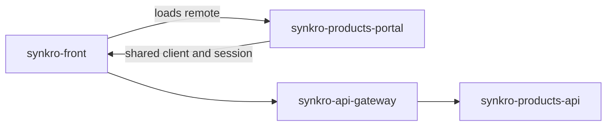

# synkro-products-portal

> Products web remote for catalog/category management, stock adjustments, stock lookup and alert views.

Part of the **SynkroTech SAS Sales Management System**. Architecture, decisions and
contracts live in [synkro-docs](https://github.com/code-corhuila/synkro-docs).

**Quick start:** from this root with Node 22, run `npm ci` and `npm run build`; mount the compiled remote through synkro-front. See [Getting started](#getting-started).

## What it does

- Provides catalog and category management to ADMIN and INVENTORY.
- Lets SALESPERSON inspect stock through a read-only view.
- Displays the alerts maintained by the Worker and supports catalog export.
- Uses shell/apiClient; the Host owns session and route authorization.

## Where it fits



The standalone page is not a second authenticated application. The Host supplies session, transport, global navigation and the browser-facing backend origin.

## Tech stack

| Component | Choice |
|---|---|
| Language / UI | TypeScript; React 19 |
| Build | Vite; @originjs/vite-plugin-federation |
| Tests | Vitest; compiled boundary checks |
| Runtime | NGINX remote, exposed internally on platform |

## Dependencies

| Depends on | Purpose | Configuration |
|---|---|---|
| synkro-front | Shared client, identity and remote entry | VITE_SHELL_ENTRY_URL |
| synkro-products-api | Published domain operations | Host client through gateway |

## Getting started

Use **PowerShell or Bash** from this repository root with Node 22. Prepare local build inputs from `.env.example`.

```text
npm ci
npm run build
npm run preview
```

Build the remote before loading it in the Host. Preview is for local assets; the authenticated UI is mounted through the Host. For a container deployment, the Host serves the owning `/remotes/products/` prefix.

For the complete platform, start from [synkro-infra-postgres](https://github.com/code-corhuila/synkro-infra-postgres).

## Configuration

The committed [.env.example](.env.example) is the configuration inventory.
Its values are examples; required inputs and defaults follow its comments and the
owning implementation. Keep real secrets in protected local files.

| Variable | Purpose |
|---|---|
| `VITE_SHELL_ENTRY_URL` | Connection address, origin or build-time entry point |

Browser build inputs and runtime NGINX inputs differ. VITE_* changes require rebuilding; HOST_ORIGIN controls the served origin where declared in deploy/compose.yml.

## Interface

| Entry / route | Use |
|---|---|
| ./App | Exposed federation modules |
| /products | ADMIN / INVENTORY catalog and management |
| /stock | SALESPERSON read-only stock |
| /stock-alerts | ADMIN / INVENTORY read-only alerts |

## Project structure

```text
src/products/   API calls, models, pages and components
src/            exposed App, routes and navigation
deploy/         remote image, NGINX and Compose
scripts/        compiled-output boundary checks
docs/           detailed screen and deployment behavior
```

## Testing

```text
npm run lint
npm test
npm run build
npm run check:compiled
```

Unit tests use Host doubles; they do not certify a real backend deployment. Detailed delivery notes retain their original reported test and browser-evidence limits.

## Branching and contributing

Use a `feat/`, `fix/` or `chore/` child branch and a PR into `develop`.
Permanent branches are `develop`, `qa` and `main`; none accepts direct commits.
Promote through a `qa-<description>` or release child with `git cherry-pick -x`.
`main` requires approval from `ariel5253`. Use English Conventional Commits.
See [Git conventions](https://github.com/code-corhuila/synkro-docs/blob/main/00-governance/git-conventions.md).

## Further documentation

- [Portal integration](docs/portal-integration.md).
- [Screens](docs/screens.md).
- [Deployment](docs/deployment.md).
- [Implementation boundaries](docs/implementation-boundaries.md).
- [Local development](docs/local-development.md).
- [Domain rules](https://github.com/code-corhuila/synkro-docs/blob/main/02-domain/entities-and-rules.md), [contracts](https://github.com/code-corhuila/synkro-docs/tree/main/07-api/contracts/openapi) and [testing strategy](https://github.com/code-corhuila/synkro-docs/blob/main/11-quality/testing-strategy.md).

<!-- Preserve previously published README section links. -->
<a id="branching"></a>
<a id="what-this-repository-is"></a>
<a id="screens"></a>
<a id="http-client-and-session"></a>
<a id="folder-layout"></a>
<a id="products-list-products"></a>
<a id="registering-a-product-products"></a>
<a id="managing-products-and-categories-products"></a>
<a id="stock-lookup-stock"></a>
<a id="stock-alerts-stock-alerts"></a>
<a id="low-stock-products"></a>
<a id="navigation-between-screens"></a>
<a id="other-behaviour-worth-knowing"></a>
<a id="deployment"></a>
<a id="notes-on-the-real-service"></a>
<a id="conformance-with-the-front-end-convention"></a>
<a id="repository-readiness"></a>
<a id="styling"></a>
<a id="running-locally"></a>
<a id="scripts"></a>
<a id="root-composition-delivery"></a>
